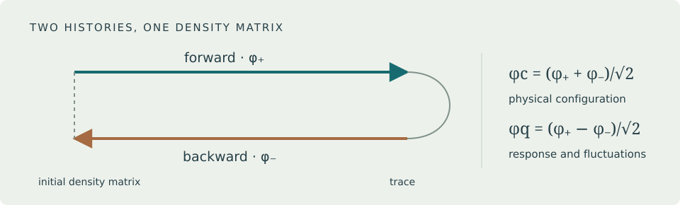

# Welcome {.unnumbered}

::: {.content-visible when-format="html"}
```{=html}
<div class="hero">
<p class="eyebrow">An open physics notebook · First edition</p>
<p class="lead">Start with a density matrix. End with collective behavior that remembers how a quantum system is driven.</p>

<a class="book-button" href="00-orientation.html">Start reading →</a>
<a class="book-button" href="keldysh-field-theory.pdf">Download the PDF</a>
</div>
<div class="reading-grid">
<div class="reading-card"><strong>Build the language</strong><p>Density matrices, coherent states, the time contour, Green functions, and noise.</p><a href="01-prerequisites.html">The foundations →</a></div>
<div class="reading-card"><strong>Follow the physics</strong><p>Cavity transitions, spin glasses, condensation, KPZ fluctuations, and heating.</p><a href="07-cavity-spins.html">The applications →</a></div>
<div class="reading-card"><strong>Work it through</strong><p>Intermediate algebra, solved exercises, and reproducible Julia calculations.</p><a href="12-numerical-laboratory.html">The laboratory →</a></div>
</div>
```
:::

## What this book does

This book develops the machinery needed to study interacting quantum systems with coherent evolution, driving, and dissipation on equal footing. Its backbone is the review by Sieberer, Buchhold, and Diehl, *Keldysh Field Theory for Driven Open Quantum Systems* [@Sieberer2016]. The organization follows the review's scientific progression, with additional prerequisites, intermediate derivations, worked problems, and numerical checks. @sec-review-map maps its substantive sections to this book.

The intended reader knows undergraduate quantum mechanics, statistical mechanics, calculus, and linear algebra. A previous course in quantum field theory is useful but is not assumed. The mathematical appendix develops the functional derivatives and Gaussian integrals used in the text. The chapters introduce approximations where they enter and distinguish exact identities, controlled limits, truncation-dependent results, and numerical evidence.

The central question is concrete: when pumping and losses determine a many-body state, which properties can be predicted from symmetry and long-wavelength dynamics, without solving every microscopic detail?

## How to study it

Read @sec-orientation, then work through the foundations in order. Keep the @sec-conventions nearby: factors of two in decay rates and in the classical/quantum rotation are a common source of mistakes. After the symmetry and renormalization chapters, the spin and boson applications can be studied independently. The heating chapter uses both Green functions and kinetic reasoning.

Each chapter supplies intermediate calculations and exercises with worked answers. Pause before reading a solution. A useful standard for understanding is being able to reproduce a result with the conventions stated here and explain why its assumptions are needed. @sec-laboratory makes several such checks executable using only Julia's standard libraries.

This is a first edition of an independent teaching companion, prepared with AI assistance for Ze-Yu Xing. It is not an edition of the published review and is not affiliated with its authors or publisher. The writing, diagrams, and example calculations are original to this project. Source papers are credited for their results. Scientific corrections are welcome through the repository's issue tracker; a successful software build does not constitute an independent expert review of every derivation.

## Four questions to carry through the book

1. **What evolves?** A density operator evolves under a Liouvillian; the contour turns this operator equation into a field integral.
2. **What fluctuates?** Response and correlation are independent away from equilibrium. Their distinction is visible in the Keldysh matrix.
3. **What survives coarse graining?** Symmetries, conservation laws, noise, and dimensionality constrain the long-distance theory.
4. **What can be measured?** Cavity output, spatial coherence, response spectra, and structure factors connect the field theory to observations.

The bibliography provides attribution and routes to further study. Definitions and derivations needed for the main narrative are included in the book itself.
